# TadeoeCar — 4WD4WS Autonomous Mobile Robot

<div align="center">
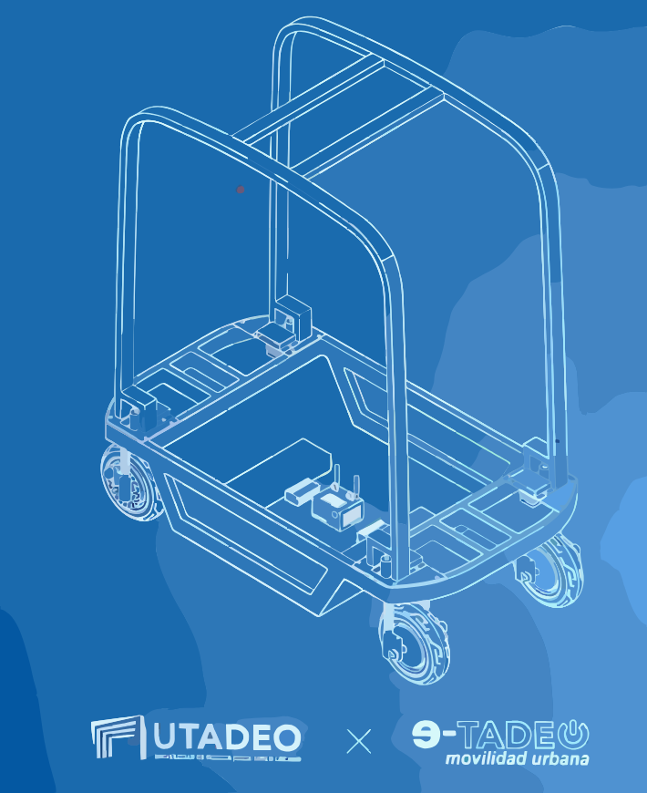

[](#)
[](#)
[](#)
[](#)
[](#)
[](#)
[](LICENSE)

</div>

> A four wheel drive, four wheel steering electric platform for indoor and yard
> material transport. Every wheel drives and every wheel steers, so the robot
> can follow a car-like path, spin on the spot, or crab sideways without
> changing heading. Built on ROS 2 Humble and Ignition Gazebo Fortress, with a
> ZED 2i stereo camera, a YDLIDAR X2 at each end, and an estimator that knows
> the ground is not always flat.

---

## Quick start

```bash
# 1. Dependencies. Read from the packages' own manifests, so this list cannot
#    drift out of step with what the code actually imports.
source /opt/ros/humble/setup.bash
rosdep update                                  # first time only
rosdep install --from-paths src --ignore-src -y

# 2. Build
colcon build --symlink-install && source install/setup.bash

# 3. Drive it: Gazebo, RViz and a browser interface on http://localhost:8080
ros2 launch tadeocar_bringup demo.launch.py

# Or map with the LiDAR
ros2 launch tadeocar_bringup slam_bringup.launch.py

# Or navigate autonomously
ros2 launch tadeocar_bringup navigation_bringup.launch.py

# Or build a 3D map with the camera
ros2 launch tadeocar_bringup vslam_bringup.launch.py
```

Every launch above takes `world:=factory|yard|empty`, `headless:=true` to run
without the Gazebo window, and `rviz:=false` to run without RViz.

Ubuntu 22.04 with ROS 2 Humble is assumed. If `rosdep` is not set up yet,
`sudo rosdep init` once, then `rosdep update`.

Full instructions: [docs/installation-guide.md](docs/installation-guide.md) ·
[docs/usage-guide.md](docs/usage-guide.md)

---

## Contents

- [The robot](#the-robot)
- [Sensors](#sensors)
- [What makes 4WD4WS different](#what-makes-4wd4ws-different)
- [Simulation environments](#simulation-environments)
- [System architecture](#system-architecture)
- [Attitude-aware localisation](#attitude-aware-localisation)
- [LiDAR SLAM](#lidar-slam)
- [Autonomous navigation](#autonomous-navigation)
- [RGB-D visual SLAM](#rgb-d-visual-slam)
- [Mathematical model](#mathematical-model)
- [Specifications](#specifications)
- [Project structure](#project-structure)
- [Documentation](#documentation)

---

## The robot

A low flatbed on four independently steered wheels with coil-over suspension,
under a tubular steel arc that carries the camera, built by the robotics
research group at Universidad de Bogotá Jorge Tadeo Lozano.

<div align="center">
<table>
  <tr>
    <td>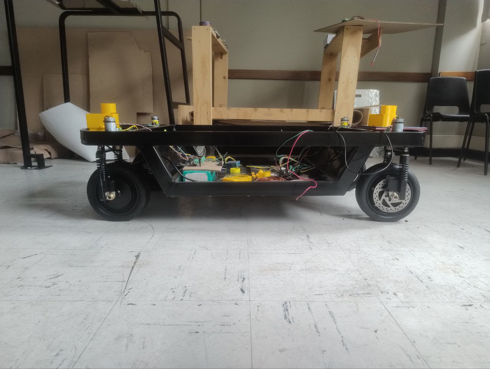</td>
    <td>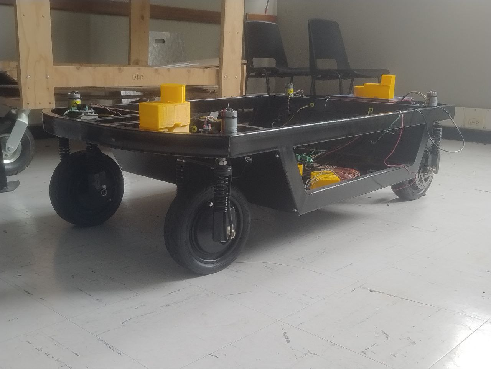</td>
  </tr>
  <tr>
    <td>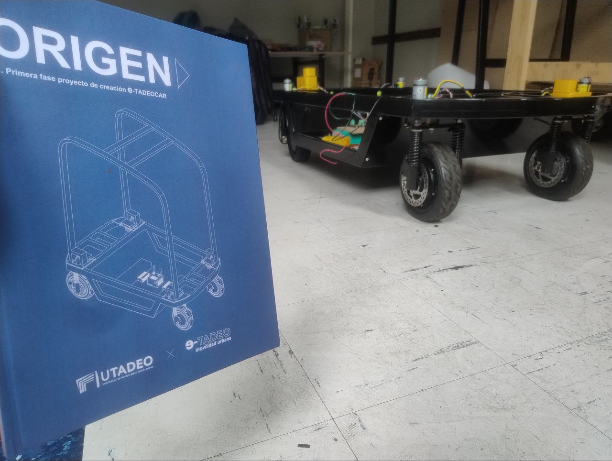</td>
    <td>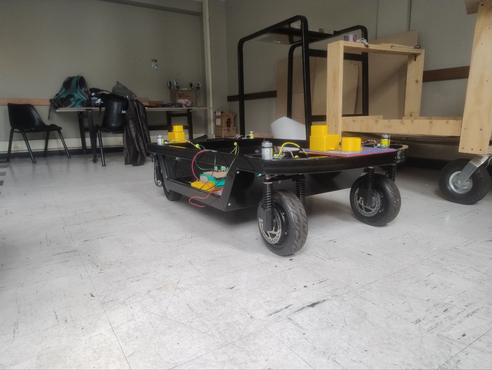</td>
  </tr>
</table>
</div>

And the same machine in simulation, as it is being fitted out: the upper
chassis seated on a 3 mm aluminium tread plate, a LiDAR at each end of the
deck, the ZED 2i bolted to the arc's lower front cross tube, and road lamps
under the deck's lips. Every label points at a coordinate projected from the
model itself:

<div align="center">
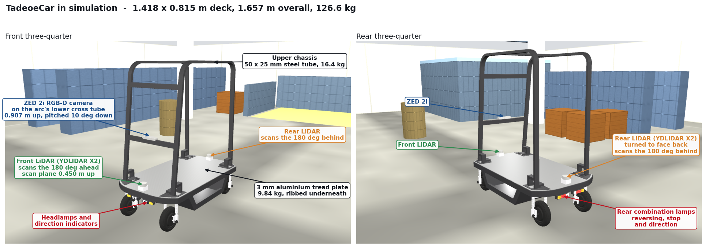
</div>

Every part was checked numerically before it went into the model: the arc
against the deck it stands on, both LiDARs' fields of view against the arc's
posts, the camera's field of view against the frame, and each lamp against
everything that turns with a wheel, swept a full 360 degrees about its
steering axis. The closest any lamp comes to a tyre or a strut is 75 mm.

---

## Sensors

<div align="center">
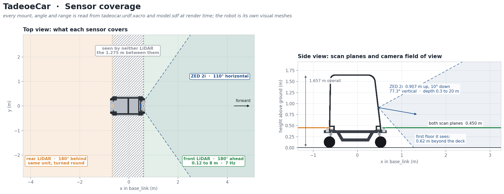
</div>

*Drawn from the model, not by hand: every mount, angle and range on it is read
from `tadeocar.urdf.xacro` and `model.sdf` by
[render_sensors.py](docs/mathematical-model/render_sensors.py).*

**Two LiDARs, half a revolution each.** The same YDLIDAR X2 sits at each end
of the deck, scanning 0.450 m above the ground, 58 mm over the tread plate.
Each one uses only the 180 degrees it faces: the other half of its sweep looks
across the deck, at the arc's posts, the other sensor and whatever is loaded,
and would only ever see the robot. `scan_merger` in `tadeocar_perception`
joins the two halves into the one 360 degree `/scan` that SLAM Toolbox, AMCL
and both costmaps read, moving the rear half through odometry to the front
half's timestamp so the two agree while the robot is moving. What neither
sees is the strip beside the robot between them, 1.275 m long.

<div align="center">
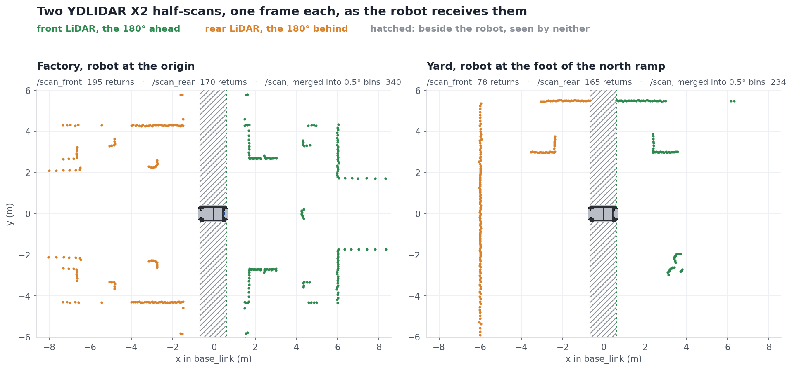
</div>

*One frame from each half-scan, in both worlds, as the robot receives it.*

**One camera, high and looking down.** The ZED 2i rides on the arc's lower
front cross tube, 0.907 m up and pitched 10 degrees down: far above both LiDAR
planes, so it can never occlude them, and with both front posts outside its
110 degree field. The first floor it can see is 0.62 m beyond the deck's front
edge; nearer than that, at bumper height, is the front LiDAR's. Its colour and depth feed
RTAB-Map, and its IMU, the only inertial sensor on the robot, feeds the
estimator.

<div align="center">
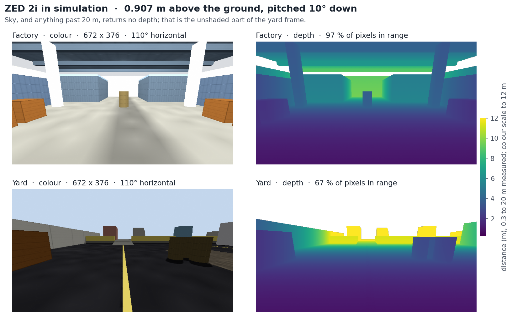
</div>

---

## What makes 4WD4WS different

Most mobile robot software assumes one of two things: that the wheels are
fixed and the robot turns by driving them at different speeds, or that the
wheels roll in two directions at once. Neither is true here.

The TadeoeCar steers conventional tyres. Sideways motion comes from *pointing*
four wheels, not from rolling sideways, and pointing them takes about half a
second for a 90 degree change. That single fact shapes the whole stack:

- The controller **gates wheel torque on steering error**, so a wheel is not
  dragged sideways while its servo is still swinging.
- The path follower is **Regulated Pure Pursuit rather than DWB**, because a
  sampling controller scores trajectories the robot cannot execute yet.
- The odometry is an **overdetermined least-squares fit** over four wheels
  rather than a closed form over two.

Three driving modes are available on `/robot_mode`:

| Mode | Behaviour | Used for |
|---|---|---|
| `omnidirectional` | every wheel points along its own velocity | the default; any body twist, exactly |
| `ackermann` | front wheels steer, rear stay straight | paths a car could also follow |
| `crab` | all four wheels at one angle | translate without turning, heading held by a closed loop |

---

## Simulation environments

Two worlds, and neither is hand-written. Each is emitted by a Python script
that produces the Gazebo world **and** the Nav2 occupancy grid from the same
list of primitives, so the map and the building cannot disagree.

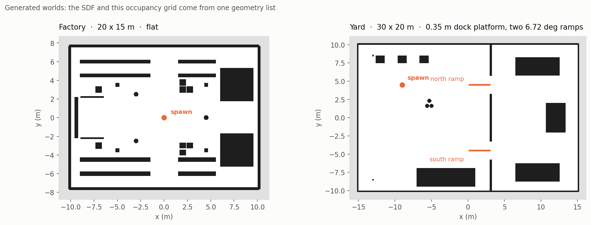

<div align="center">
<table>
  <tr>
    <td>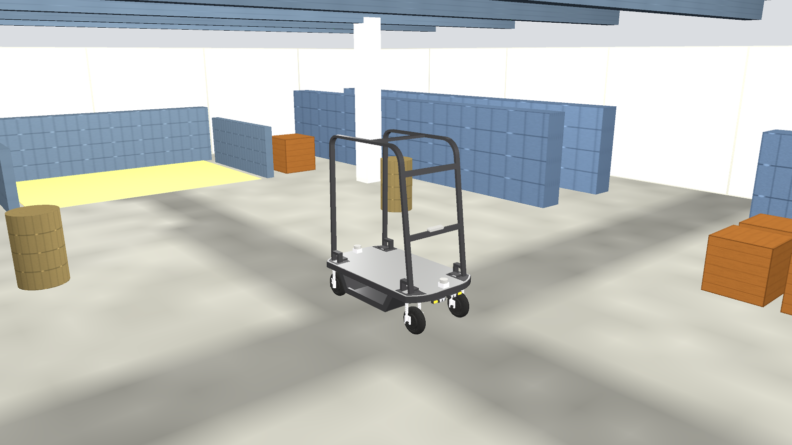</td>
    <td>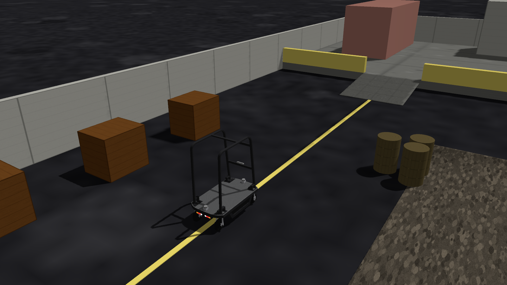</td>
  </tr>
  <tr>
    <td align="center"><i>Factory: racks, pillars, roof trusses, bay lighting</i></td>
    <td align="center"><i>Yard: the dock platform and both ramps, seen from the apron</i></td>
  </tr>
</table>
</div>

**Factory** — 20 × 15 m of warehouse: rack rows, machinery, pillars, crates,
a loading bay. Flat, textured, roofed. This is where planning and mapping are
judged.

**Yard** — 30 × 20 m of outdoor apron with a 0.35 m dock platform reached by
two 6.72° ramps forming a closed loop, and an apron split into asphalt
(μ 0.90), gravel (μ 0.55) and sand (μ 0.30) patches carrying genuinely
different friction. This world exists to break two assumptions the rest of the
stack makes: that the ground is flat, and that friction is a constant.

The generators refuse to emit a world whose layout is unusable — a blocked
corridor, two models sharing space, or an obstacle in the **blind band**
between wheel height (0.125 m) and the LiDAR plane (0.450 m), where a thing
exists in the physics and in no sensor.

---

## System architecture

### Packages

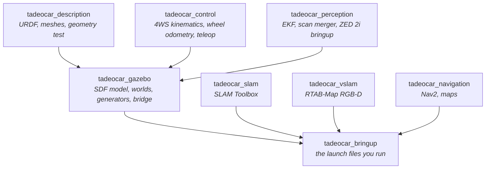

### Data flow

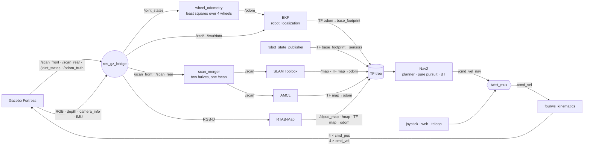

SLAM Toolbox, AMCL and RTAB-Map all publish `map → odom`, but never at the same
time: mapping, navigation and visual SLAM are separate launches.

### Transform tree

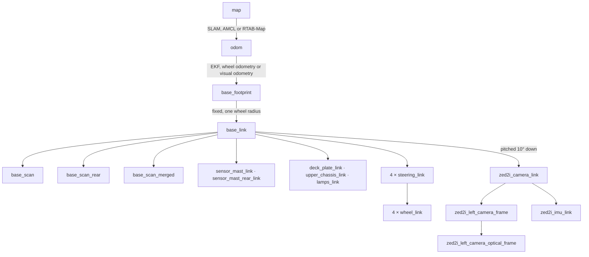

`odom → base_footprint` has exactly **one** publisher, chosen by the
`odom_source` argument. A frame gets one parent, and two publishers of one
transform is a broken tree, not a merged one.

---

## Attitude-aware localisation

Wheel odometry solves a planar problem. It takes four wheel speeds and four
steering angles and returns a velocity in the ground plane, because that is all
those sensors can support: an encoder measures rotation, and rotation says how
far the tyre rolled, not which way "along the ground" was pointing at the time.

Drive the yard world's ramp and the consequence is exact rather than
approximate.

<div align="center">
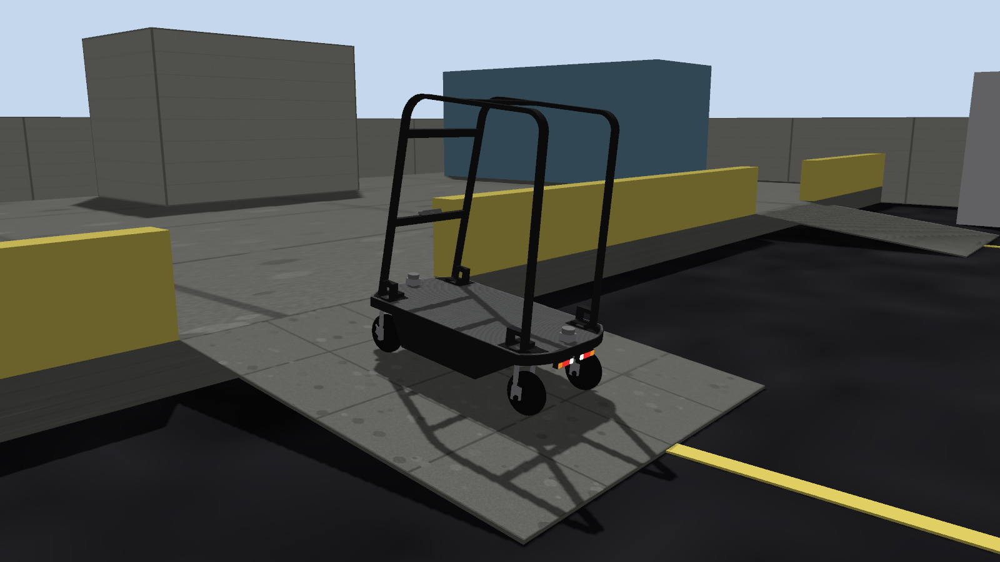
</div>

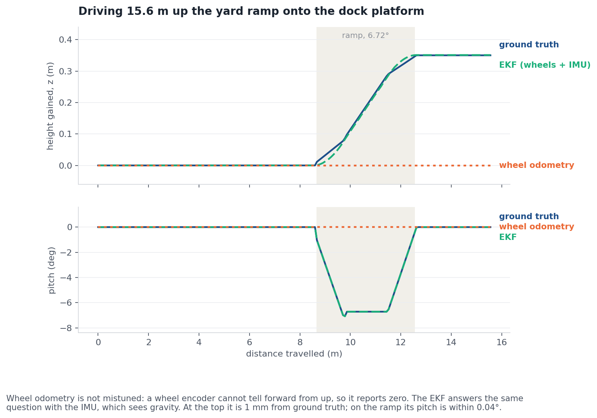

| | ground truth | wheel odometry | EKF |
|---|---|---|---|
| height on the dock platform | 0.350 m | **0.000 m** | 0.351 m |
| pitch, mid-ramp | −6.72° | 0.00° | −6.72° |
| pitch on flat ground | 0.00° | 0.00° | 0.00° |

The EKF in `tadeocar_perception` fuses the ZED 2i's IMU with the wheels'
velocity. Attitude comes from gravity — an accelerometer at rest knows which
way is down — so the filter integrates the wheels' speed through the attitude
the IMU measures rather than through an assumed-flat world.

The IMU sits in the camera, which is pitched 10 degrees on its wedge.
`robot_localization` takes that mount out through TF, which only works if the
sensor reports its attitude against the world, the way gravity gives it to
the real BMI088; the simulated IMU is configured to (`orientation_reference_frame`
ENU). Left at Gazebo's default it reports attitude relative to its own pose at
spawn, and the filter, correctly removing a mount the sensor had not
reported, tilted the robot 10 degrees nose up on flat ground.

Absolute yaw is fused from nothing at all: this robot has no magnetometer, and
the simulated IMU's orientation is ground truth in disguise, so fusing it would
make the simulation look better than the hardware can ever be. Heading drifts,
exactly as it will on the real robot, and correcting it is SLAM's job one level
up.

See it for yourself:

```bash
ros2 launch tadeocar_bringup demo.launch.py                # fused
ros2 launch tadeocar_bringup demo.launch.py use_ekf:=false # dead reckoning
```

---

## LiDAR SLAM

```bash
ros2 launch tadeocar_bringup slam_bringup.launch.py
```

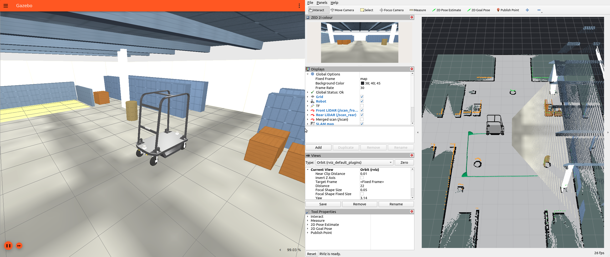

*Gazebo and RViz, one command. The map on the right is being built from the
scene on the left.*

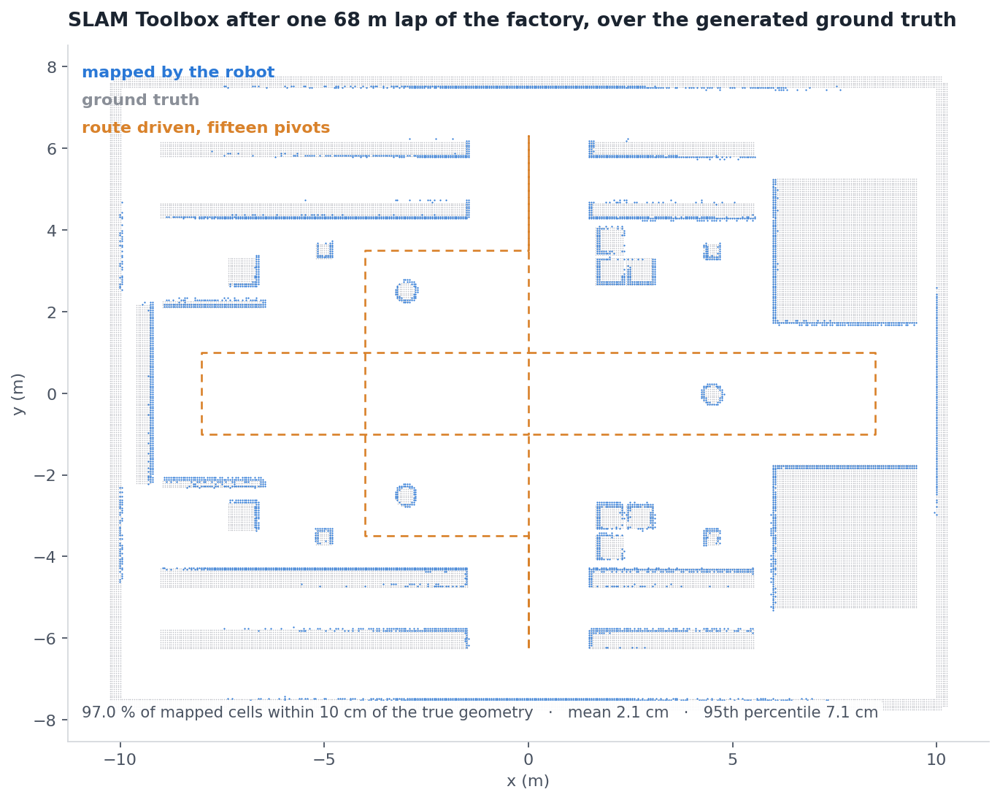

Because the world is generated, the occupancy grid it emits is not an
approximation of the building — it *is* the building, rasterised at 5 cm. That
turns "does the map look right" into a measurement.

Measured over a 68 m lap of the factory with fifteen pivots on the spot, the
route in orange above:

| Metric | Result |
|---|---|
| Mapped cells within 10 cm of true geometry | **95.5 %** |
| Mean error | 2.2 cm |
| Median error | 0.0 cm |
| 95th percentile | 7.1 cm |
| Fused pose (EKF) after the same lap | 0.29 m, 0.7° |
| Wheel odometry after the same lap | 2.5 m, 33° |

On the same lap with the single 360 degree LiDAR the model used to carry, the
map scored 97.3 % within 10 cm and a 5.0 cm 95th percentile. Two half-scans,
blind beside the robot, map the building within two points of what one full
scan did. Method and caveats:
[docs/slam-validation.md](docs/slam-validation.md).

---

## Autonomous navigation

```bash
ros2 launch tadeocar_bringup navigation_bringup.launch.py
```

Nav2 with **Regulated Pure Pursuit** as the local controller. Five goals across
the factory, scored against ground truth on arrival:

| Goal (x, y, heading) | Time | Position error | Heading error |
|---|---|---|---|
| (6.0, 0.0, 0°) | 12.0 s | 26.6 cm | 7.3° |
| (8.5, 0.0, 0°) | 4.6 s | 27.8 cm | 6.8° |
| (0.0, −5.0, −90°) | 19.5 s | 35.6 cm | 8.5° |
| (−6.0, 0.0, 180°) | 16.2 s | 20.2 cm | 8.2° |
| (0.0, 0.0, 0°) | 13.9 s | 23.2 cm | 13.0° |

**5 of 5 reached**, every one inside Nav2's own tolerance by its own estimate
and within 0.36 m of the request by ground truth.

The yard is the harder of the two, because reaching the dock means climbing a
ramp the planner never sees as one: the generator emits ramps and platform as
traversable floor, not as obstacles.

```bash
ros2 launch tadeocar_bringup navigation_bringup.launch.py world:=yard
```

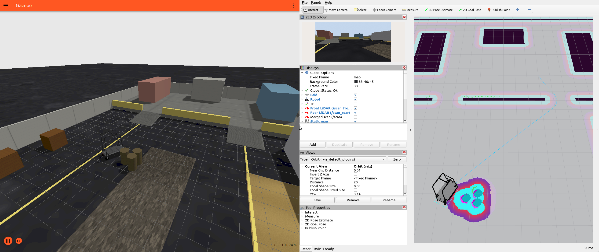

*The yard, seconds after a goal on the dock platform was sent: the static map,
both costmaps, the plan and each LiDAR's half. The map follows the world
unless `map` names one explicitly, and which one was picked is logged at
startup.*

| Goal (x, y, heading) | Time | Position error | Heading error |
|---|---|---|---|
| (−4.0, 4.5, 0°) | 8.7 s | 17.2 cm | 2.5° |
| (6.0, 4.5, 0°) | 14.2 s | 25.8 cm | 2.2° |
| (6.0, −3.0, −90°) | 13.5 s | 22.1 cm | 13.5° |

**3 of 3 reached.** The last two stand on the dock platform, where ground truth
reports z = 0.350 m, so the route went up the ramp.

DWB was tried first and does not suit this platform: it settled into commanding
±0.09 rad/s on alternate cycles with the wheels parked at −60°, and the robot
vibrated in place until the progress checker aborted the goal. The reasoning is
in [docs/mathematical-model/control.md](docs/mathematical-model/control.md) §4.

---

## RGB-D visual SLAM

```bash
ros2 launch tadeocar_bringup vslam_bringup.launch.py
```

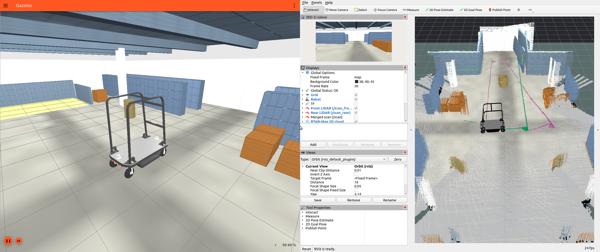

*The accumulated RTAB-Map cloud on the right is built from the camera alone;
magenta is camera-only odometry, green the EKF.*

RTAB-Map on the ZED 2i's RGB-D stream, with **camera-only odometry**: nothing
but the images decides where the robot is. Measured over the same 68 m factory
lap with fifteen pivots, with the camera on its new mount, 0.907 m up and
pitched 10 degrees down, against the old one at 0.30 m:

| Metric | Camera at 0.30 m | Camera at 0.907 m, two runs |
|---|---|---|
| Feature inliers, median | 145 | **158–178** (peak 740) |
| Frames with no inliers | 3.8 % | **2.3–2.9 %** |
| Camera-only pose at the end of the lap | 10.3 m out | 3.6–14.6 m out |
| EKF pose at the end of the same lap | 0.07 m | 0.25 m |

The higher camera registers better. It does not survive turning **on the
spot** any better: the estimate is lost a pivot at a time, and where it ends
depends on which pivots it loses, which is why two runs of the same lap end
3.6 and 14.6 m out. In a straight line it holds. Details in
[docs/visual-slam.md](docs/visual-slam.md).

The first version of this tracked nothing — 13 % of frames failed registration
and the estimate ended 18 m out — and no amount of RTAB-Map tuning moved it.
The cause was that the worlds were rendering **flat-shaded**: Gazebo resolves a
relative texture URI against the directory of the file that names it, not
against `GZ_SIM_RESOURCE_PATH`, so every `albedo_map` in the world silently
failed to load. A corner detector needs intensity gradients, and a flat-shaded
box has none anywhere except its silhouette. Fixing the path, roofing and
lighting the building, and emitting long walls as 2.5 m panels took the inlier
count from 53–65 to a median of 211.

The ZED is simulated as a single `rgbd_camera` at 672 × 376, the camera's own
VGA mode. Its point cloud is **reprojected from the depth image through
`camera_info`** rather than bridged from Gazebo: gz-sensors emits its cloud in
the sensor's body axes while `camera_info` is optical, and one `gz_frame_id`
cannot label both conventions. The reprojection is also what the ZED SDK does
on real hardware. ROS-side topic names match `zed-ros2-wrapper`, so swapping
the simulated camera for the physical one changes nothing above the bridge.

Mapping on the fused EKF pose instead (`odom_source:=ekf`) reaches 0.06 m and
demonstrates less. The full account, including everything that did not work, is
in [docs/visual-slam.md](docs/visual-slam.md).

---

## Mathematical model

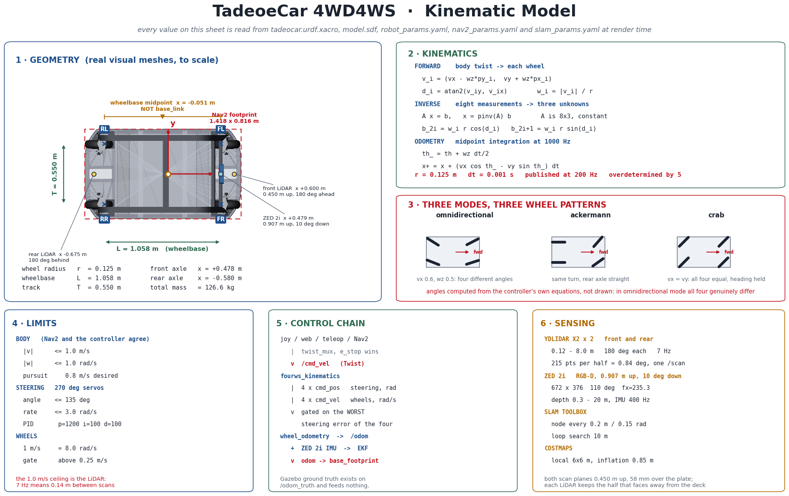

That sheet is generated, not drawn. Every value on it is read from
`tadeocar.urdf.xacro`, `model.sdf`, `robot_params.yaml`, `nav2_params.yaml`
and `slam_params.yaml` at render time, and the robot is drawn from its own
visual meshes seen from above. The sensor coverage figure is made the same
way:

```bash
source /opt/ros/humble/setup.bash
python3 docs/mathematical-model/render_diagram.py
python3 docs/mathematical-model/render_sensors.py
```

Change a parameter and re-run it; the figure cannot go stale.

The kinematics, the control loops and every physical constant, with the
measurements that justify them:

| Document | Covers |
|---|---|
| [Overview](docs/mathematical-model/README.md) | notation, the two governing equations, validation summary |
| [Kinematics](docs/mathematical-model/kinematics.md) | geometry, the three modes, least-squares odometry |
| [Control](docs/mathematical-model/control.md) | arbitration, steering loop, drive gate, path following |
| [Parameters](docs/mathematical-model/parameters.md) | every constant, with its source |

The two equations everything else follows from — forward, body twist to wheels:

$$\delta_i = \operatorname{atan2}(v_y + \omega_z p_{x,i},\ v_x - \omega_z p_{y,i}),
\qquad \omega_i = \frac{\lVert \mathbf{v}_i \rVert}{r}$$

and inverse, eight wheel measurements to three body velocities, by least
squares:

$$\boldsymbol{\xi} = \mathbf{A}^{+}\mathbf{b}$$

---

## Specifications

| Parameter | Simulation | Physical robot |
|---|---|---|
| Wheelbase | 1.058 m | 1.058 m |
| Track | 0.550 m | 0.550 m |
| Wheel radius | 0.125 m | 0.125 m |
| Deck | 1.418 × 0.815 m, top 0.389 m above ground | same |
| Deck surface | 3 mm aluminium tread plate on two ribs | planned |
| Upper chassis | 50 × 25 mm steel tube arc, 1.353 × 0.775 × 1.265 m | same design |
| Overall height | 1.657 m | same design |
| Mass | 126.6 kg | not yet weighed |
| Steering | 4 × revolute, ±135° | 4 × industrial servo, 270° |
| Drive | 4 × velocity-controlled joint | 4 × BLDC, 2 × ODrive S3 |
| Max speed | 1.0 m/s, 1.0 rad/s | limited by the same controller |
| LiDAR | 2 × YDLIDAR X2 model, front and rear: 0.12–8 m, 180° each, 7 Hz, merged into one `/scan` | YDLIDAR X2 at the front; the rear one planned |
| Camera | ZED 2i model: 672 × 376, 110° HFOV, RGB-D, 0.907 m up, pitched 10° down | ZED 2i over USB 3.0, to be moved onto the arc |
| IMU | BMI088 noise model, 400 Hz, attitude against the world | inside the ZED 2i |
| Lamps | headlamps and indicators in front, combination lamps behind | planned |
| Compute | host PC | Jetson Nano 4 GB |
| Power | — | 2 × 24 V LiPo |

The speed ceiling is the LiDAR's, not the drivetrain's: the scan turns at 7 Hz,
so at 2 m/s the robot moves 0.29 m between scans and scan matching has to
bridge that gap on odometry alone.

---

## Project structure

```
src/
  tadeocar_description/   URDF, meshes, the scripts that generate the tread
                          plate and lamp meshes, and the tests that keep the
                          URDF and the Gazebo model agreeing
  tadeocar_gazebo/        Gazebo model, world generators, textures, bridge
  tadeocar_control/       4WS kinematics, wheel odometry, teleoperation
  tadeocar_perception/    EKF state estimation, the LiDAR scan merger,
                          ZED 2i bringup
  tadeocar_slam/          SLAM Toolbox
  tadeocar_vslam/         RTAB-Map RGB-D visual SLAM
  tadeocar_navigation/    Nav2 configuration and maps
  tadeocar_bringup/       the launch files a person actually runs
```

Full breakdown, topics and frames:
[docs/project-structure.md](docs/project-structure.md).

---

## Documentation

| Document | Covers |
|---|---|
| [Installation guide](docs/installation-guide.md) | dependencies, build, troubleshooting |
| [Usage guide](docs/usage-guide.md) | every launch file and argument |
| [Project structure](docs/project-structure.md) | packages, topics, transform tree |
| [Mathematical model](docs/mathematical-model/README.md) | kinematics, control, parameters |
| [SLAM validation](docs/slam-validation.md) | how the numbers above were measured |
| [Visual SLAM](docs/visual-slam.md) | what works, what does not, and why |

---

<div align="center">
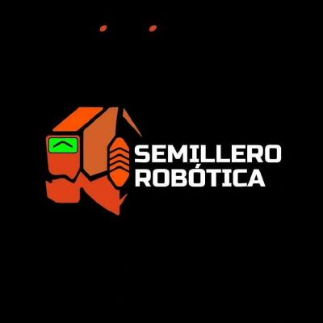

**Semillero de Robótica** · Universidad de Bogotá Jorge Tadeo Lozano

Licensed under [Apache 2.0](LICENSE)
</div>
